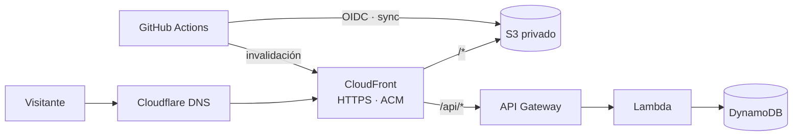

# Portfolio web — Pau Mas Sales

Mi currículum y portfolio en **[paumassales.dev](https://paumassales.dev)**, en castellano, inglés y catalán. Es una web estática hecha con Astro y Tailwind, y a la vez mi proyecto de cloud: se sirve desde AWS, con toda la infraestructura definida en **Terraform** y desplegada automáticamente con **GitHub Actions**.

## Arquitectura



| Pieza | Para qué sirve |
|---|---|
| **S3** (privado) | Guarda la web estática. Solo CloudFront puede leerlo (Origin Access Control). |
| **CloudFront** | CDN con HTTPS (certificado de ACM), cabeceras de seguridad y una CloudFront Function que añade `index.html`, redirige `www` y elige el idioma. |
| **API Gateway + Lambda + DynamoDB** | Contador de visitas serverless, servido bajo el mismo dominio en `/api`, con límite de peticiones. |
| **Cloudflare** | DNS del dominio (se compró allí); Terraform crea los registros. |
| **GitHub Actions + OIDC** | Compila y despliega en cada push a `main`, sin guardar claves de AWS en el repositorio. |
| **AWS Budgets** | Alertas de coste. |

## Stack

- **Web:** [Astro](https://astro.build) + [Tailwind CSS](https://tailwindcss.com) + TypeScript
- **Infraestructura:** Terraform (providers `aws`, `cloudflare` y `archive`), estado remoto en S3 con bloqueo
- **Backend:** AWS Lambda (Node.js 22) y DynamoDB
- **CI/CD:** GitHub Actions

## Estructura

```
src/
  pages/{es,en,ca}/   Páginas por idioma (rutas con prefijo)
  components/         Componentes de Astro
  data/               Contenido: projects.ts (proyectos) y cv.ts (currículum)
  assets/             Imágenes (se optimizan al compilar)
  lambda/             Código de la función del contador de visitas
terraform/            Infraestructura como código (ver terraform/README.md)
scripts/              Generación de los PDF del currículum
.github/workflows/    Despliegue automático
```

## Desarrollo local

Requiere Node.js 22.

```bash
npm install
npm run dev          # servidor en http://localhost:4321
npm run check        # comprobación de tipos (astro check)
npm run lint         # ESLint (también se ejecuta en el CI)
npm run format       # formatea el código con Prettier
npm run build        # compila en dist/
```

En local el contador de visitas muestra un número de ejemplo; solo funciona de verdad en producción, donde existe la API.

## Currículum

El contenido del CV está en un único archivo, `src/data/cv.ts`, con los tres idiomas. De ahí salen la página web y los PDF:

```bash
npm run cv:pdf       # compila la web y genera public/cv-es.pdf, cv-en.pdf y cv-ca.pdf
```

El script usa Chrome o Chromium sin interfaz (variable `CHROME_BIN` si no está en el PATH) y comprueba que cada PDF ocupe una sola página. Los campos marcados como "solo web" amplían la web sin cambiar el PDF.

## Infraestructura y despliegue

Los pasos para crear la infraestructura (bucket del estado, `terraform apply` y variables de GitHub) están en [`terraform/README.md`](terraform/README.md). Una vez creada, cada push a `main` compila la web, la sube a S3 e invalida la caché de CloudFront.

## Notas de diseño

- **Sin CORS:** la API cuelga del mismo dominio que la web (CloudFront enruta `/api/*`), así que no hace falta.
- **Sin claves de larga duración:** GitHub Actions asume un rol de AWS por OIDC, restringido a la rama `main` de este repositorio.
- **Mínimo privilegio:** la Lambda solo puede leer y actualizar su tabla; el rol de despliegue solo puede escribir en el bucket e invalidar esta distribución.
- **Control de costes:** un presupuesto mensual con alertas, y el uso de la web cabe en la capa gratuita; solo el dominio tiene coste fijo.
